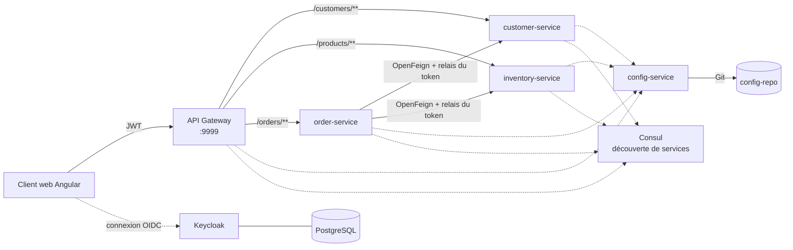
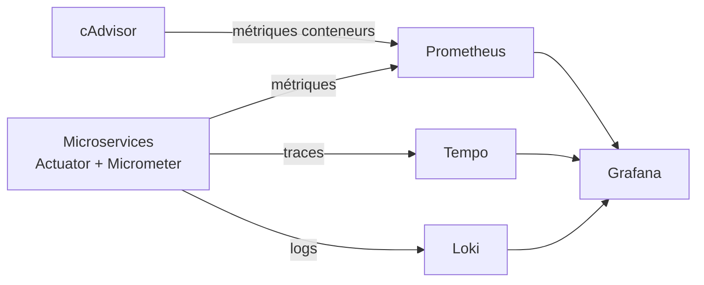
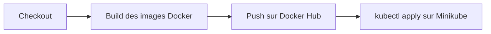

<p align="right"><a href="README.md">EN</a> | <b>FR</b></p>

# K8s Microservices

Application e-commerce en microservices Spring Cloud, sécurisée par Keycloak, déployée sur Kubernetes via un pipeline Jenkins et supervisée avec la stack Grafana (Prometheus, Loki, Tempo).


## Architecture



| Composant | Rôle |
|---|---|
| **geteway-service** | Spring Cloud Gateway : point d'entrée unique, routage, CORS, validation des JWT |
| **customer-service** | Gestion des clients (Spring Data REST, projections) |
| **inventory-service** | Catalogue produits |
| **order-service** | Commandes ; appelle les services clients et produits via OpenFeign en transmettant le token OAuth2 de l'utilisateur |
| **config-service** | Spring Cloud Config Server, adossé au dépôt Git [config-repo](https://github.com/saber0amine/config-repo) |
| **Consul** | Registre et découverte de services (StatefulSet sur Kubernetes) |
| **Keycloak** | Fournisseur d'identité (OpenID Connect), stockage PostgreSQL |
| **ecom-web-app** | Front-end Angular 17 avec `keycloak-angular`, servi par Nginx |

## Sécurité

Les utilisateurs s'authentifient auprès de Keycloak depuis l'application Angular. Chaque requête porte un JWT que la gateway et chaque service valident en tant que resource server OAuth2 ; les rôles Keycloak sont convertis en autorités Spring par un `JwtAuthConverter` dédié. Pour les appels entre services, un `OAuth2FeignRequestInterceptor` propage le token depuis `order-service` vers les services appelés.

## Observabilité



- **Métriques :** endpoints `/actuator/prometheus` collectés par Prometheus, avec histogrammes de latence HTTP.
- **Traçage distribué :** Micrometer Tracing (Brave), échantillonnage à 100 % ; `traceId` et `spanId` injectés dans chaque ligne de log.
- **Tableaux de bord :** Grafana avec dashboard et sources de données préconfigurés ([docker/grafana](docker/grafana)).

## CI/CD

Le [Jenkinsfile](Jenkinsfile) automatise toute la chaîne de livraison :



Les manifestes Kubernetes se trouvent dans [kubernetes-Manifests](kubernetes-Manifests) :

| Dossier | Contenu |
|---|---|
| `Springboot-k8s-main/` | Deployments et Services de chaque microservice, de la gateway, Consul, Keycloak (avec Ingress), PostgreSQL, MySQL, Adminer et du client web |
| `observability-manifests/` | Prometheus, Grafana, Loki, Tempo et cAdvisor |

Les services attendent leurs dépendances (Config Server, Consul) grâce à des init containers avant de démarrer.

## Démarrage

### Kubernetes (Minikube)

```bash
minikube start
kubectl apply -f kubernetes-Manifests/Springboot-k8s-main/
kubectl apply -f kubernetes-Manifests/observability-manifests/
```

| Service | NodePort |
|---|---|
| Client web | 32542 |
| API Gateway | 31769 |
| Keycloak | 31095 |
| Adminer | 31085 |

### Docker Compose

```bash
docker compose up -d
```

Lance les microservices, Consul et Vault en local (gateway sur le port 9999).

## Structure du projet

```text
.
├── config-service/          Spring Cloud Config Server
├── customer-service/        Microservice clients
├── inventory-service/       Microservice produits
├── order-service/           Microservice commandes (OpenFeign)
├── geteway-service/         Spring Cloud Gateway
├── ecom-web-app/            Front-end Angular
├── kubernetes-Manifests/    Manifestes Kubernetes
├── docker/                  Configuration Prometheus, Grafana et Tempo
├── docker-compose.yml
└── Jenkinsfile
```
