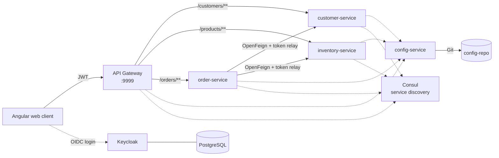
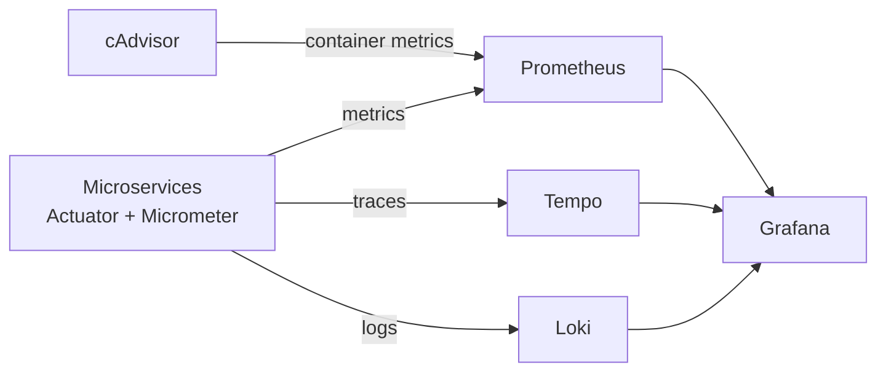

<p align="right"><b>EN</b> | <a href="README.fr.md">FR</a></p>

# K8s Microservices

An e-commerce application built as Spring Cloud microservices, secured with Keycloak, deployed on Kubernetes through a Jenkins pipeline and monitored with the Grafana stack (Prometheus, Loki, Tempo).


## Architecture



| Component | Role |
|---|---|
| **geteway-service** | Spring Cloud Gateway: single entry point, routing, CORS, JWT validation |
| **customer-service** | Customer management (Spring Data REST, projections) |
| **inventory-service** | Product catalog |
| **order-service** | Orders; calls the customer and inventory services through OpenFeign, forwarding the user's OAuth2 token |
| **config-service** | Spring Cloud Config Server, backed by the [config-repo](https://github.com/saber0amine/config-repo) Git repository |
| **Consul** | Service registry and discovery (StatefulSet on Kubernetes) |
| **Keycloak** | Identity provider (OpenID Connect), PostgreSQL storage |
| **ecom-web-app** | Angular 17 front end with `keycloak-angular`, served by Nginx |

## Security

Users authenticate against Keycloak from the Angular app. Each request carries a JWT that the gateway and every service validate as an OAuth2 resource server; Keycloak roles are mapped to Spring authorities by a custom `JwtAuthConverter`. For service-to-service calls, an `OAuth2FeignRequestInterceptor` propagates the token from `order-service` to the downstream services.

## Observability



- **Metrics:** `/actuator/prometheus` endpoints scraped by Prometheus, with HTTP latency histograms.
- **Distributed tracing:** Micrometer Tracing (Brave), 100% sampling; `traceId` and `spanId` injected into every log line.
- **Dashboards:** Grafana with a preconfigured dashboard and data sources ([docker/grafana](docker/grafana)).

## CI/CD

The [Jenkinsfile](Jenkinsfile) automates the whole delivery chain:


The Kubernetes manifests are in [kubernetes-Manifests](kubernetes-Manifests):

| Folder | Content |
|---|---|
| `Springboot-k8s-main/` | Deployments and Services for each microservice, the gateway, Consul, Keycloak (with Ingress), PostgreSQL, MySQL, Adminer and the web client |
| `observability-manifests/` | Prometheus, Grafana, Loki, Tempo and cAdvisor |

Services wait for their dependencies (Config Server, Consul) with init containers before starting.

## Getting started

### Kubernetes (Minikube)

```bash
minikube start
kubectl apply -f kubernetes-Manifests/Springboot-k8s-main/
kubectl apply -f kubernetes-Manifests/observability-manifests/
```

| Service | NodePort |
|---|---|
| Web client | 32542 |
| API Gateway | 31769 |
| Keycloak | 31095 |
| Adminer | 31085 |

### Docker Compose

```bash
docker compose up -d
```

Starts the microservices, Consul and Vault locally (gateway on port 9999).

## Project structure

```text
.
├── config-service/          Spring Cloud Config Server
├── customer-service/        Customer microservice
├── inventory-service/       Product microservice
├── order-service/           Order microservice (OpenFeign)
├── geteway-service/         Spring Cloud Gateway
├── ecom-web-app/            Angular front end
├── kubernetes-Manifests/    Kubernetes manifests
├── docker/                  Prometheus, Grafana and Tempo configuration
├── docker-compose.yml
└── Jenkinsfile
```
